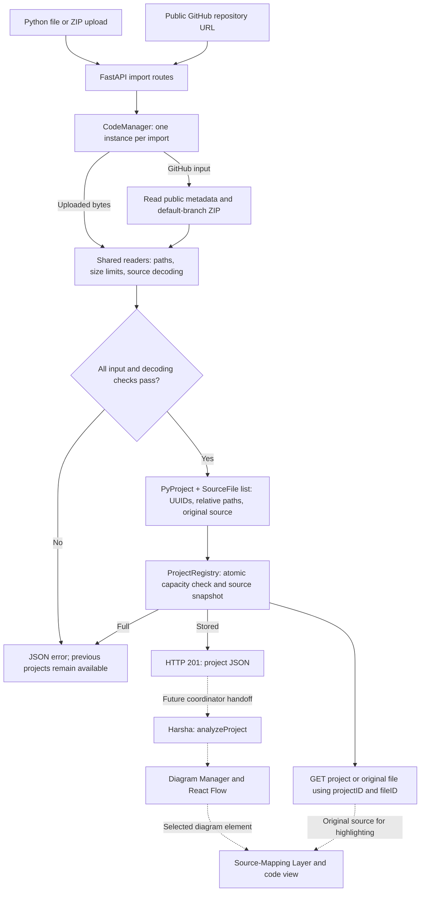

# FlowBridge Code Manager

Code Manager imports a Python file, ZIP project, or public GitHub repository into
one shared `PyProject` contract. It preserves decoded original source for Harsha's
parser and the Source-Mapping Layer. It does not execute or parse imported code.

The existing HTML, CSS, and JavaScript remain the team's frontend prototype.
The backend can be demonstrated independently through its CLI and FastAPI docs.

## How the module works



Solid arrows show implemented behavior. Dashed arrows show the team integration
still to connect. Input validation checks file formats, paths, resource limits,
and source encoding; Python syntax errors remain original text for Harsha's parser.
The API returns a project only after all eligible files pass import checks and
the registry accepts the complete source snapshot.

## Stack and module size

The Stage 2 slides recommend FastAPI and pytest for the Python backend; both are
used here. React, React Flow, and Vitest belong to the UI/diagram work. SQLite is
the proposed persistence option; this demo uses the in-memory registry requested
by the detailed module specification. Pydantic v2 and HTTPX provide the shared
models and GitHub requests required by that specification.

The runtime package and compatibility module total 1,035 physical Python lines,
including spacing/docstrings, or 820 excluding blank lines, comments, and
docstrings. The `CodeManager` service itself is 109 physical lines. Tests add
1,150 lines, and the generated `uv.lock` adds 550; those are separate from the
runtime implementation. Most input-handling code covers source preservation,
ZIP validation, GitHub redirects/timeouts, and safe error handling.

## Install and start

Use Python 3.12 and [uv](https://docs.astral.sh/uv/getting-started/installation/).
Run these commands from the repository root:

```powershell
uv sync --locked
uv run uvicorn flowbridge.api:app --host 127.0.0.1 --port 8000
```

Open <http://127.0.0.1:8000/docs> for working file, ZIP, and GitHub import controls.
`GET /health` returns `{"status":"ok"}`. Use one server worker for this in-memory
demo: separate workers/processes have separate project registries.

Optional GitHub token, set before starting the backend:

```powershell
$env:GITHUB_TOKEN = "your-token"
```

Public repositories work without a token. Do not commit tokens. The backend reads
the process environment; it does not automatically load a `.env` file.

## Test and demonstrate

```powershell
uv run pytest -q --cov=flowbridge --cov-report=term-missing
uv run ruff check .
uv run ruff format --check .

uv run flowbridge-code file examples/sample_project/app/main.py
uv run python -c "import shutil; shutil.make_archive('demo-project', 'zip', 'examples/sample_project')"
uv run flowbridge-code zip demo-project.zip --project-name "Nested demo"

# Optional live smoke test; excluded from automated tests, requires internet:
uv run flowbridge-code github https://github.com/jerphan/CodeToChart

# Real local server smoke test; starts/stops its own server, no GitHub requests:
uv run python scripts/smoke_api.py
```

`uv run python -m flowbridge file <path.py>` is an equivalent CLI entry point.
The CLI accepts supplied local files; the HTTP API accepts uploads and never opens
a caller-provided server-local pathname. JSON goes to stdout. Import errors go to
stderr with exit code 1.

## HTTP contract

| Route | Input | Success |
| --- | --- | --- |
| `POST /api/projects/file` | Multipart `file`, optional `projectName` | 201, project JSON |
| `POST /api/projects/zip` | Multipart `file`, optional `projectName` | 201, project JSON |
| `POST /api/projects/github` | JSON `url`, optional `projectName` | 201, project JSON |
| `GET /api/projects/{projectID}` | Project ID | 200, project JSON |
| `GET /api/projects/{projectID}/files/{fileID}` | Both IDs | 200, original SourceFile JSON |
| `GET /health` | None | 200, health JSON |

The import response is the project itself, with no transport wrapper:

```json
{
  "projectID": "9d2e8c32-9480-4e32-9aaf-27149b1dfe87",
  "projectName": "StudentProject",
  "files": [
    {
      "fileID": "8f54f2df-6bb9-4a7e-b62c-940be0ec924b",
      "fileName": "main.py",
      "filePath": "app/main.py",
      "fileContent": "print('hello')\n"
    }
  ]
}
```

IDs in this example are illustrative. Each fresh import gets new UUIDs. Retain
the returned IDs when calling the parser or retrieving original source.

Errors consistently use `{"error":{"code":"...","message":"..."}}`, optionally
including a safe relative `filePath`. Invalid request fields return 400, including
FastAPI validation failures. See the handoff for all codes and limits.

## Team handoff

- [Integration contract, behavior, limits, and responsibilities](docs/CODE_MANAGER_HANDOFF.md)
- [Verification evidence and intended-user validation checklist](docs/VALIDATION.md)
- [Slide-ready bullets for Justin's module](docs/POWERPOINT_BULLETS.md)
- [Class diagram source](docs/diagrams/code-manager-class.mmd)
- [Upload sequence source](docs/diagrams/upload-sequence.mmd)
- [GitHub sequence source](docs/diagrams/github-sequence.mmd)

The original `from CodeManager import ...` imports still work. `pyProject` and
`sourceFile` are aliases to `PyProject` and `SourceFile`.

## Repository integration

The implementation is on `codex/code-manager`, based on commit
`9fdaf1fa0c898b709bbf443647dcb1f7fb2950e7`. Review the branch and its checks before
merging into `main`. Keep the shared field names and IDs when connecting the UI,
parser, and source-mapping modules. Installation and demonstration commands above
apply after checking out the implementation branch.
